<h1 align="center"> MimicAgent: Language-Driven Whole-Body Skill Generation

for Humanoid Motion Data </h1>

<div align="center">

An LLM agent that writes, simulates, checks and repairs humanoid motion — from one sentence.

[[Architecture]](docs/ARCHITECTURE.md)
[[Adding a Robot]](docs/ADDING_A_ROBOT.md)
[[Skill Guide]](docs/SKILL_GUIDE.md)

[](https://mujoco.readthedocs.io/)
[](https://www.python.org/)
[](https://www.anthropic.com/claude)
[](https://github.com/langchain-ai/langgraph)
[](https://ubuntu.com/)
[](LICENSE)

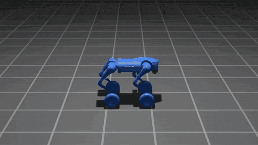

*MimicAgent skill library, generated end-to-end from natural language.*

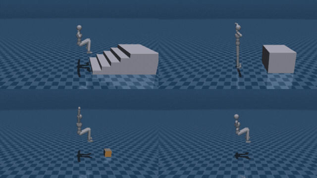

*This repository — the humanoid half. Unedited agent output: stair climb, ledge mantle, box carry, cartwheel.*

</div>

## 📚 Table of Contents

1. **[Overview](#overview)**
   - Docs: [Architecture](docs/ARCHITECTURE.md) • [Adding a Robot](docs/ADDING_A_ROBOT.md) • [Skill Guide](docs/SKILL_GUIDE.md)

2. **[Installation](#installation)**
   2.1 [Conda Environment](#conda-environment)
   2.2 [Install Dependencies](#install-dependencies)
   2.3 [API Key](#api-key)
   2.4 [Verify the Installation](#verify-the-installation)

3. **[Generating Skills](#generating-skills)**
   3.1 [One Skill from One Sentence](#one-skill-from-one-sentence)
   3.2 [What Lands in the Output Directory](#what-lands-in-the-output-directory)
   3.3 [Writing Prompts That Work](#writing-prompts-that-work)
   3.4 [Interactive Demo](#interactive-demo)

4. **[Skill Gallery](#skill-gallery)**

5. **[Replaying and Scoring](#replaying-and-scoring)**
   5.1 [Replay a Skill](#replay-a-skill)
   5.2 [Score the Whole Set](#score-the-whole-set)
   5.3 [Debug Tools](#debug-tools)

6. **[Scenes and Environment Interaction](#scenes-and-environment-interaction)**

7. **[Adding a New Humanoid](#adding-a-new-humanoid)**

8. **[How It Works](#how-it-works)**
   8.1 [The Pipeline](#the-pipeline)
   8.2 [The Skill Contract](#the-skill-contract)
   8.3 [What a Skill Must Satisfy](#what-a-skill-must-satisfy)
   8.4 [Environment Variables](#environment-variables)

9. **[Repository Layout](#repository-layout)**

10. **[Citation](#citation)**

11. **[Acknowledgements](#acknowledgements)**

12. **[License](#license)**

## TODO

- [x] Release the kinematic MuJoCo simulator and skill contract
- [x] Release the LangGraph plan → code → simulate → repair pipeline
- [x] Release the morphology-agnostic robot spec (one YAML drives sim + prompts)
- [x] Release robot-agnostic scenes (flat, stairs, ledge, chair, carry-box)
- [x] Release the physics floor + agent-declared fidelity invariants
- [x] Release the pre-simulation geometry lint (reach, surface, ballistic)
- [x] Release MimicKit-compatible `.pkl` export
- [ ] Unify the quadruped and humanoid pipelines into one MimicAgent framework
- [ ] Release parkour scenes (vault, gap, wall)
- [ ] Release RL tracking policies trained on the generated data

# Overview

MimicAgent turns a natural-language skill description into **motion data**.

An LLM agent plans the motion, writes a motion-generator class, executes it in a
**purely kinematic MuJoCo** simulator, scores the recorded trajectory against
physical laws *and* against fidelity invariants **the agent itself declared**, then
repairs its own code until the motion is both legal and recognizably the thing that
was asked for. Trajectories export in **MimicKit-compatible** `.pkl` format for
downstream imitation learning (DeepMimic and friends).

The design goal is that the **prompt** is the only limit. Nothing in the framework
is skill-specific:

- **Morphology-agnostic.** One spec file, `robots/<name>/robot.yaml`, drives both the
  simulator and every prompt. No code path hardcodes a leg, a hand, or a gait.
- **Scene-agnostic.** Scenes are environments only — floor and objects, no robot. The
  simulator composes any robot with any scene at load time.
- **No skill heuristics.** There is no pose cookbook and no per-skill branch. Which of
  the three control channels drives a limb in a phase is the **agent's** decision, made
  per limb per phase.
- **General laws, not label gates.** Every check is a physical law that self-skips when
  out of domain — never a test keyed on the word "walk" or "jump".

> [!IMPORTANT]
> The simulator is **kinematic**, not dynamic. It solves IK and records poses; it does
> not simulate contact forces. The checks are what keep the output physically honest,
> and every framework correction (target clamps, floor assist, reach seating, rate
> limiting) is **bounded and recorded** so an impossible authoring stays visible rather
> than being silently smoothed away.

# Installation

Tested on Linux with Python 3.10–3.13.

## Conda Environment

```bash
conda create -n mimicagent python=3.11
conda activate mimicagent
```

## Install Dependencies

```bash
git clone https://github.com/Luckykantnayak/go2_data_generation.git
cd go2_data_generation
pip install -r requirements.txt
```

<details>
<summary>Optional: the constrained QP IK backend</summary>

The default IK is a damped-least-squares solver built into the repo. An optional
[mink](https://github.com/kevinzakka/mink) backend solves each frame as a QP with joint
position limits, velocity limits and collision avoidance as **hard** constraints:

```bash
pip install mink 'qpsolvers[daqp]'
IK_BACKEND=mink python simulator/run.py --robot humanoid
```

It is **not** the default. Measured trade-off: its constraints are genuinely stronger,
but the first-order velocity solve tracks authored targets more loosely, and the contact
laws score *achieved* positions — so it trades violations it makes impossible for a
tracking lag that reads as contact drift. See `simulator/utils/kinematics.py:make_ik`.
The simulator falls back to DLS with a loud warning if mink is absent; it never crashes.

</details>

## API Key

```bash
export ANTHROPIC_API_KEY="..."
```

Only the generation pipeline needs this. Replaying and scoring skills do not.

## Verify the Installation

```bash
# Plays the robot's reference walk in a viewer window.
python simulator/run.py --robot humanoid --record True
```

> [!IMPORTANT]
> Run **every** command from the repository root. `simulator/run.py` puts its own
> directory on `sys.path`, but data paths (`robots/`, `assets/`, `skill_output/`) are
> resolved relative to the repo root.

<details>
<summary>Note: expected startup warnings</summary>

You will see `⚠️ Site not found` warnings and `[IK] Sites found: 4/15`. This is correct.
The humanoid's 4 end-effectors have `ee_*` sites in the MJCF; the 11 extra
`contact_bodies` (pelvis, torso, head, knees, thighs, forearms, upper arms) declare no
site, so IK aims at the body origin and their `ground_offset` carries the vertical.

The viewer needs a display. Pass `--headless True` to skip GLFW/GL and the real-time
throttle entirely — that is what the agent does, and it is roughly 10× faster.

</details>

# Generating Skills

## One Skill from One Sentence

```bash
cd agent
python run.py --skill "The humanoid walks forward at a steady pace" --name SKILL_WALK
```

The agent plans, writes code, lints it pre-simulation, runs the rollout headless, scores
the trajectory, and repairs — up to `critic.max_iters` iterations (default 7), with one
full replan available if it stalls.

## What Lands in the Output Directory

Everything for a skill lives in `skill_output/<robot>/<SKILL_NAME>/`. A **finished**
directory contains only the deliverables — the winning version's code, its plan, the
exact prompt that produced it, both trajectory formats, and a preview GIF:

```
skill_output/humanoid/SKILL_WALK/
├── SKILL_WALK.py               # the best-scoring version (not necessarily the last)
├── SKILL_WALK_plan.json        # the motion plan: phases, contacts, channels, invariants
├── SKILL_WALK_prompt.md        # the exact prompt that produced this code
├── SKILL_WALK.pkl              # eval trajectory + collision/contact arrays
├── SKILL_WALK_mimickit.pkl     # MimicKit motion {fps, loop_mode, frames}
├── SKILL_WALK.gif              # preview render
└── metadata.json               # tokens + wall time
```

Mid-run the same directory is per-iteration (`SKILL_WALK_0003.py`,
`motion_plan_0003.json`, `report_0003.json`, …); finalization copies the best version
forward, re-runs the simulation to guarantee the shipped `.pkl` matches the shipped
code, renders the GIF, and deletes every intermediate.

## Writing Prompts That Work

Prompt phrasing affects motion quality more than any framework knob. A worked
before/after: a box-carry failed every attempt until the description added *"stands back
up to full height, carries it upright"* — same framework, immediate fix.

Full guidance, including what to leave **out**, is in
[`docs/SKILL_GUIDE.md`](docs/SKILL_GUIDE.md).

<details>
<summary>Bypassing the feasibility gate</summary>

A `skill_filter` node vetoes descriptions it judges infeasible for the robot. For
deliberately aggressive requests (aerial and expressive moves), bypass it:

```bash
SKIP_SKILL_FILTER=1 python run.py --skill "..." --name SKILL_X
```

</details>

## Interactive Demo

```bash
cd agent
streamlit run app.py
```

# Skill Gallery

Agent-generated, one invocation each, rendered straight from the recorded trajectories.

|  |  |
|:--:|:--:|
| 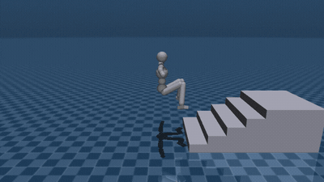 | 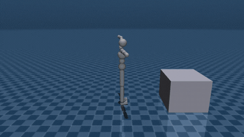 |
| **Stair climb** — `stairs` | **Ledge mantle** — `ledge` |
| 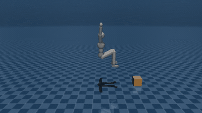 | 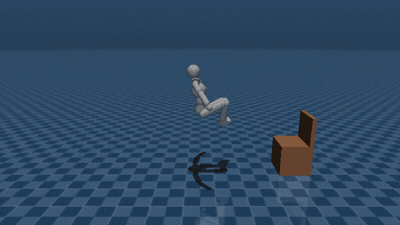 |
| **Box carry** — `carry_box` | **Sit on a chair** — `chair` |
| 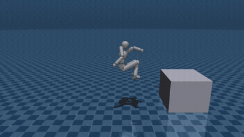 | 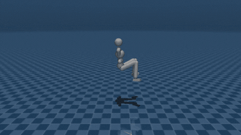 |
| **Ledge drop** — `ledge` | **Cartwheel** — `flat` |
| 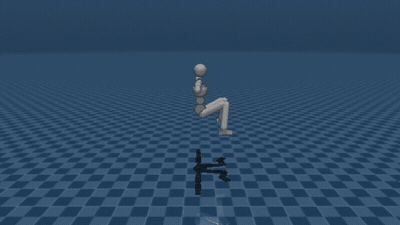 | 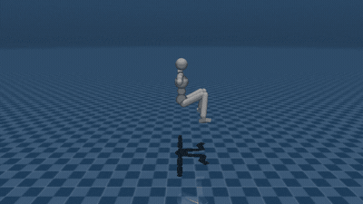 |
| **Front flip** — `flat` | **Side flip** — `flat` |
| 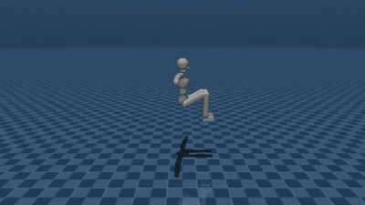 | 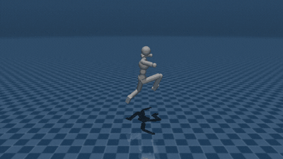 |
| **Ballet spin** — `flat` | **Celebration jump** — `flat` |

> [!IMPORTANT]
> Generation is **non-deterministic** and run-to-run variance is large — the same prompt
> can produce a clean motion on one invocation and a failing one on the next. Judge the
> framework across a few runs, not one. See
> [Run-to-run variance](docs/SKILL_GUIDE.md#run-to-run-variance-is-large).

# Replaying and Scoring

## Replay a Skill

```bash
python simulator/run.py --robot humanoid --mode SKILL_WALK --record True
```

`--mode` resolves a **generated** skill first, then a curated exemplar — matching the
controller's own load order — and reads that skill's scene, grounding and repetitions
from its motion plan. A bare replay therefore **reproduces** the agent's recording.

Override any of the three explicitly; precedence is CLI flag > the skill's plan >
config default:

```bash
python simulator/run.py --robot humanoid --mode SKILL_WALK \
  --scene assets/scenes/stairs.xml --grounding off --record_cycles 4 --record True
```

## Score the Whole Set

`finalize` deletes the per-iteration reports, so this is the only way to answer *"did
that framework change help?"* — it re-scores every shipped skill against the **same**
evaluator the pipeline uses.

```bash
python agent/score_skills.py --json before.json      # snapshot
# ... make a framework change ...
python agent/score_skills.py --compare before.json   # diff
```

## Debug Tools

All three instantiate the **same** `MotionControllerRunner` as the live simulator, so
what they measure is what plays.

```bash
# Reachability oracle. The pipeline calls this before every rollout; run it by hand to
# debug a "PRE-SIM LINT FAILED" message. Pass --scene for a generated skill — only
# registered exemplars auto-resolve one.
python simulator/tools/reach_lint.py --mode SKILL_X --robot humanoid --grounding off

# Offscreen mp4/gif render, no display needed.
python simulator/tools/record_video.py --robot humanoid --mode SKILL_X --out /tmp/x.gif

# Live viewer for dialling in a named stance by hand; exports paste-ready YAML.
python simulator/tools/pose_editor.py --robot humanoid
```

# Scenes and Environment Interaction

Scenes are **robot-agnostic** environments in `assets/scenes/` — floor and objects, no
robot. `simulator/utils/scene_compose.py` composes a robot with a scene at load, so any
scene works with any robot.

| scene | contents | registered as |
|---|---|---|
| `flat.xml` | ground plane only (default) | `flat` |
| `stairs.xml` | a five-step staircase | `stairs` |
| `slab.xml` | a raised platform / ledge | `ledge` |
| `chair.xml` | a seat panel + backrest | `chair` |
| `carry.xml` | a movable mocap crate on the floor | `carry_box` |

Named environments are registered per robot under `environments:` in
`robots/<name>/robot.yaml`, each binding a scene to a grounding mode and an object list.
The planner picks one by name; the executer runs the simulation with that scene.

The **exact geometry** of every scene — per-step tread heights, slab extents, box pose,
and the distance from the robot's home keyframe — is parsed straight out of the scene
XML by `agent/utils/scene_geometry.py` and injected into the prompts. It is never
hand-described. Before this, the agent got only a name and a blurb, so it guessed: it
climbed 2 of 5 steps and planted feet where no tread was.

To add an object, drop a new `assets/scenes/<env>.xml` (a mocap body for something
carried, a static geom for something fixed) and register it under `environments:`. A
request for an unregistered environment prints a `⚠️ MISSING ASSET` warning naming what
to add.

See [`docs/SKILL_GUIDE.md#scene-interaction-skills`](docs/SKILL_GUIDE.md#scene-interaction-skills).

# Adding a New Humanoid

Assets, one spec file, one reference skill. **No prompt or code changes.**

```bash
# 1. Drop the MuJoCo model + meshes under assets/robots/<name>/

# 2. Scaffold the spec (exact values from the MJCF; guesses are marked # REVIEW)
python simulator/tools/gen_robot_spec.py --robot <name>

# 3. Write robots/<name>/example.py — a BaseMotionGenerator subclass, the reference demo

# 4. Generate the physical summary + machine-readable ceilings
python simulator/tools/gen_robot_summary.py --robot <name>

# 5. Point the agent at it: set robot.name in agent/cfg/config.yaml

# 6. It plays immediately
python simulator/run.py --robot <name>
```

`robots/<name>/robot.yaml` is the **single source of truth** — end-effectors, contact
bodies, joints and limits, base-height envelope, camera, and the free-text robot card
injected into every prompt. Both halves of the system read it; nothing else encodes
morphology.

<details>
<summary>MJCF format requirements</summary>

Following these makes the spec auto-scaffoldable and the dynamics extractable:

- the root body carries the `<freejoint>`
- each end-effector body has a `<site name="ee_<name>"/>` — this both marks it for
  auto-detection and gives IK a real target (no site ⇒ IK falls back to the body centre)
- each actuated joint has a `range` (position limits) **and** an `actuatorfrcrange`
  (torque, N·m) — the torque source is what yields per-joint velocity/acceleration
  ceilings
- passive joints have no actuator
- a `<keyframe name="home">` holds the rest pose
- mass/inertia come from `<inertial>` tags or geom density

The dynamics tier is automatic: emitted when the MJCF carries mass/inertia **and** a
torque source, otherwise skipped. Both the prompt summary and the velocity check
self-omit; the robot still runs.

</details>

Full walkthrough — every `robot.yaml` field, the `example.py` contract, the constants
that are scale-dependent, and a verification checklist — in
[`docs/ADDING_A_ROBOT.md`](docs/ADDING_A_ROBOT.md).

# How It Works

## The Pipeline

A LangGraph state machine (`agent/run.py`):

```
skill_filter → motion_planner → code_generator → code_executer → unit_test_router
                    ↑                                 ↑                 │
                    │                            critic_coder ← motion_diagnosis
                    │                                 ↑                 ↑
                    └── replan ──────────────────  (repair)      critic_router ← unit_test
                                                                        │
                                                       finalize (best version) → END
```

- **`skill_filter`** gates feasibility and can veto straight to `END`.
- **`motion_planner`** emits one JSON plan: environment, phase timeline, per-phase
  contact schedule, the control channel for each free limb, and the **fidelity
  invariants** this skill must satisfy.
- **`code_generator`** expands the plan into an explicit per-limb method table and writes
  a `BaseMotionGenerator` subclass.
- **`code_executer`** writes the file, runs a **pre-simulation geometry lint**, then runs
  the rollout as a headless subprocess.
- **`unit_test`** scores the trajectory and builds a **motion readout** — a few
  paragraphs of pure geometry (base path, per-limb contact timeline, lift, drift, gait
  phase offsets, object path) fed to diagnosis and the critic. This is *perception before
  verdict*: the loop's deepest flaw was that the critic saw only a vector of pass/fail
  lamps and never the motion, so it local-patched and the checks fought each other.
- **`replan`** fires from either router and is capped at **once** per skill. It is the
  "step back and re-decide" that a code rewrite structurally cannot do.
- **`finalize`** ships the best-scoring version — not the last.

<details>
<summary>The pre-simulation lint</summary>

Between writing the file and the rollout, `simulator/tools/reach_lint.py` rebuilds the
same controller, replays the skill's `step()` over one cycle with no IK and no rendering,
and checks the authored targets in **milliseconds** instead of a minutes-long doomed
rollout. It reads only *authored* targets, so a tracking error the solver introduces is
never blamed on the author. It hard-fails:

- a declared contact **beyond its limb's reach** from the authored base
- a declared contact **with no surface beneath it** — checked in *both* directions, since
  a limb can bear load against a surface above it (a bar hang, a pull-up, a ceiling brace)
  just as legitimately as one below
- a declared contact that **translates** — a contact is a limb held still against the
  world, so one whose authored target slides was never released
- a **chronically unreachable free limb** — gated on severity *and* persistence, because a
  brief over-reach is absorbed at runtime while a sustained one means the intent is
  silently truncated

Exemptions come from the same sources the scored laws use — spec `wheel: true`, plan
`sliding_contacts`, plan `mode: pivot` — so the oracle and the test can never disagree
about what is legal.

</details>

## The Skill Contract

Every skill subclasses `simulator/motion/base.py:BaseMotionGenerator`. There are **three
control channels**, and the discriminator is **coupling, not the limb** — nothing
prescribes a fixed channel for anything:

| channel | method | use when |
|---|---|---|
| **World IK** | `compute_ee_position_world_frame(ee, phase)` | the world fixes the endpoint — a contact on a surface, or a limb that must coincide with something it grips |
| **Body IK** | `compute_ee_position_body_frame(ee, phase)` | the target is relative to the torso — a swing foot |
| **Joint** | `compute_joint_overrides(phase)` | the limb's *shape* is the point and its endpoint is unconstrained — a gesture, a kick |

Plus `contacts(phase)` → the per-phase load-bearing set (`[]` declares ballistic flight),
`compute_object_poses(phase)` for authored object paths, and `attachments(phase)` →
`{object: [ee, ...]}`, which declares an object rigidly held and places it at its
holders' **achieved** post-IK positions, so a grip is correct by construction.

Both IK channels default to `None`, which makes IK skip that end-effector. `init_ee_pos`
and all three channels span the **union IK roster** — end-effectors *plus* declared
contact bodies — so a mid-limb contact (a knee, a forearm) is placed by returning its
world contact point and IK bends the limb to it.

## What a Skill Must Satisfy

Three tiers, and the distinction is what stops the loop from either shipping a
legal-but-wrong motion or Goodharting its own tests.

**1 — Physics floor.** Universal laws, always on, pass/fail, the primary term of the
version score: surface penetration, self-collision, support-or-ballistic, per-contact
grounding, contact no-slide, joint limits, no teleport (joint-space *and* end-effector
space), joint velocity envelope, framework-intervention saturation, and clip duration.

**2 — Gated.** The same category, but each **self-skips when out of domain**, gating only
on *physical declarations* — a `[]`-contact segment, scene objects present — never on an
editorial skill label: flight window, object grip, object continuity, object at rest,
object penetration, and unheld-no-rise (an object nothing is holding may fall, rest, or
fly ballistically, but may not climb under power).

**3 — Agent-declared fidelity invariants.** The *"does it actually look like the intended
motion?"* layer the pass/fail floor cannot express. The planner composes them from eight
general geometric primitives — net progress, peak rise, swing lift, phase offset, base
height band, object coincidence, end state, stance no-drift, and contact-over-surface.
The primitives are universal relations; all of the skill-specificity is in *which* ones
the planner picks and with what parameters.

The loop continues while **either** tier is unmet. Invariants are **planner-owned** and
read from the plan, never from the code — otherwise the critic would be the repairer
editing the test it keeps failing. If diagnosis concludes an invariant is itself wrong,
the loop must go through the **replan** edge to have the planner re-declare it.

## Environment Variables

| variable | effect |
|---|---|
| `ANTHROPIC_API_KEY` | required for generation |
| `SKIP_SKILL_FILTER=1` | bypass the feasibility gate |
| `ROBOT_NAME=<name>` | override the target robot per process (two robots can generate in parallel) |
| `IK_BACKEND=dls\|mink` | select the IK solver (default `dls`) |
| `IK_HOME_PULL`, `IK_ORI_WEIGHT` | IK tunables (defaults `0.05`, `0.4`) |
| `NO_DRAG=1` | opt in to the contact-drag lint |

Simulator safety nets, all **default ON**, each disable-able with `=0` for A/B testing:
`REACH_PROJ` · `SEAM_BRIDGE` · `SEAM_BRIDGE_JOINTS` · `GROUNDING_CLAMP` · `RATE_LIMIT` ·
`CONTINUITY_REF` · `EE_ORIENT`.

# Repository Layout

```
robots/<name>/      robot.yaml (the spec), example.py, exemplars/, summary.md, dynamics.json
assets/
├── robots/<name>/  MuJoCo model + meshes (owns its <keyframe home>)
└── scenes/         robot-agnostic environments: flat, stairs, slab, chair, carry
simulator/          the kinematic simulator
├── run.py          entry point
├── core/           simulator, controller, grounding, recorder
├── motion/         base.py (the skill contract) + the loader
├── utils/          kinematics, surfaces, reach, robot_config, scene_compose
└── tools/          gen_robot_spec, gen_robot_summary, reach_lint, record_video, pose_editor
agent/              the LLM pipeline
├── run.py          the LangGraph state machine
├── agents/         planner, coder, executer, diagnosis, critic, routers
├── prompts/        flat template set (*.txt)
├── utils/          motion quality checks, readout, scene geometry
└── cfg/config.yaml model, robot, paths, iteration cap
docs/               ARCHITECTURE.md, ADDING_A_ROBOT.md, SKILL_GUIDE.md
skill_output/       generated skills + artifacts (gitignored, regenerable)
```

# Citation

If you find this work useful, please consider citing:

```bibtex
@misc{nayak2026mimicagent,
  title  = {MimicAgent: Language-Driven Whole-Body Skill Generation for Humanoid Motion Data},
  author = {Nayak, Lucky Kant},
  year   = {2026},
  url    = {https://github.com/Luckykantnayak/go2_data_generation}
}
```

# Acknowledgements

- [MuJoCo](https://github.com/google-deepmind/mujoco) — the physics engine and its
  ray-casting primitives, which the surface layer is built on.
- [LangGraph](https://github.com/langchain-ai/langgraph) — the agent state machine.
- [Claude](https://www.anthropic.com/claude) — the planning, coding and diagnosis model.
- **MimicKit** — the humanoid model convention and the motion `.pkl` format this exports
  to, so generated trajectories drop straight into DeepMimic-style tracking pipelines.
- [mink](https://github.com/kevinzakka/mink) — the optional constrained QP IK backend.

# License

This project is licensed under the Apache License 2.0 — see the [LICENSE](LICENSE) file
for details.

---
