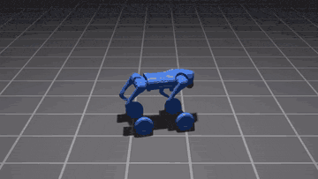

<h1 align="center">MimicAgent</h1>
<h3 align="center">Language-Driven Quadruped Motion Generation</h3>

<div align="center">

**From a skill prompt to a robot reference trajectory.**

[Website](https://luckykantnayak.github.io/mimic-agent/) ·
[Architecture](docs/ARCHITECTURE.md) ·
[Adding a Robot](docs/ADDING_A_ROBOT.md)

[](https://www.python.org/)
[](https://mujoco.org/)
[](https://www.anthropic.com/claude)
[](https://github.com/langchain-ai/langgraph)
[](LICENSE)

</div>

<p align="center">
  
  <br />
  <sub>MimicAgent project teaser</sub>
</p>

---

[Overview](#overview) · [Installation](#installation) · [Generate](#generate-a-skill) · [Replay](#replay) · [Checks](#optional-ui-and-checks)

## Overview

This repository contains the quadruped implementation of MimicAgent, with Unitree
Go2 and Go2-W models. Claude turns a natural-language request into motion-generator
code, then evaluates and repairs its trajectory in a kinematic MuJoCo simulator.

**Prompt → Plan → Code → Simulate & evaluate → Repair → Export**

Outputs include generated Python code, motion plans, evaluation reports, and
MimicKit-compatible reference trajectories. The simulator animates poses; it does
not simulate forces, contact dynamics, or balance.

## Installation

**Requirements:** Linux, Python 3.10+, a working graphical display, and an
Anthropic API key for generation. Run these commands from the repository root.

### 1. Create an environment

```bash
python -m venv .venv
source .venv/bin/activate
```

### 2. Install dependencies

```bash
python -m pip install -r requirements.txt
```

### 3. Configure Claude

```bash
export ANTHROPIC_API_KEY="your-api-key"
```

Choose an API model available to your account and the repair budget in
`agent/cfg/config.yaml`. Replaying an existing skill does not require an API key.

## Generate a skill

```bash
(cd agent && python run.py \
  --skill "The robot trots forward at a steady pace." \
  --name SKILL_TROT)
```

Generated code is saved under `skill_output/unitree_go2w/SKILL_TROT/`.
Plans, reports, trajectories, and usage metadata live in separate folders under
`skill_output/unitree_go2w/`; see [Architecture](docs/ARCHITECTURE.md).

The highest-numbered Python file is the latest attempt, **not necessarily a
passing result**. Inspect its evaluation report and replay the motion.

## Replay

After generating the skill, run:

```bash
python simulator/run.py --mode SKILL_TROT
python simulator/run.py --mode SKILL_TROT --record True --version demo
```

The first command opens continuous playback. The second records the configured
number of cycles under `skill_output/unitree_go2w/trajectories/demo/`.
Both require a display. A fresh clone contains no generated skills.

## Optional UI and checks

```bash
(cd agent && streamlit run app.py)
```

Generation evaluates base height, foot penetration, joint limits, and optional
all-feet airtime. These checks do not establish that the requested skill was
performed: inspect rotation, travel, posture, and the replay as well.
`agent/utils/test_motion_quality.py` is the pipeline scorer, not a standalone
test suite.

## Notes

- These are kinematic references. Passing checks does not prove that a controller
  can track the motion or deploy it on hardware.
- Robot specifications live in `robots/`; models and their scenes live in
  `assets/robots/`.
- Switching robots requires updating both agent and simulator configurations.
  See [Adding a Robot](docs/ADDING_A_ROBOT.md).
- Generated outputs, archives, and input skill libraries are local-only and
  excluded from Git. Batch generation requires a separately prepared library.
- See [Architecture](docs/ARCHITECTURE.md) and [License](LICENSE) for further details.
