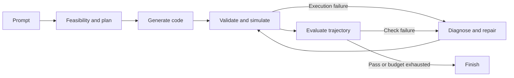

# Architecture

[README](../README.md) · [Adding a Robot](ADDING_A_ROBOT.md)

MimicAgent generates kinematic reference trajectories from natural-language prompts.
The repository follows the humanoid project's top-level organization, but has
its own quadruped interface and evaluation pipeline.

## Repository layout

| Location | Purpose |
| --- | --- |
| `agent/` | LangGraph entry points, LLM loading, planning, code generation, evaluation, repair. |
| `agent/cfg/config.yaml` | Model, repair budget, agent robot description, artifact paths. |
| `agent/prompts/templates/` | Shared text prompts loaded directly; no JSON build step. |
| `simulator/` | Playback entry point, configuration, IK, motion interface, recording. |
| `robots/<name>/robot.yaml` | Model names and limb/site mappings. |
| `assets/robots/<name>/` | MuJoCo robot XML, scene XML, meshes. |
| `docs/` | Architecture and robot integration guides. |
| `teaser.gif` | Low-resolution project teaser used by the README. |
| `skill_output/` | Generated artifacts; ignored by Git. |
| `skill_library/` | Local input libraries for batch generation; ignored by Git. |
| `archive/` | Historical runs, legacy modules, review fixtures; ignored by Git. |

## Pipeline



The CLI (`agent/run.py`) and UI (`agent/app.py`) construct their graphs separately.
The agent writes a skill file, invokes `python simulator/run.py` in a subprocess
from the repository root, then reads the recorded trajectory. Execution errors
and failed quality checks can reach the critic, bounded by `critic.max_iters`.

Agent commands run from `agent/`; simulator commands run from the repository root.
These working directories matter for imports and relative paths.

Diagnosis and repair receive the current code, plan, execution error and evaluation
feedback explicitly, along with the live base interface. They do not replay the
entire history. Source validation rejects substitute base classes, missing foot
callbacks and overrides of the fixed step/reset pipeline; runtime checks require
finite three-element foot targets.

Each API call logs its model, stop reason, token usage and visible-text length.
Normal successful calls retain the configured settings. If Sonnet 5.5 hits its
output limit, the wrapper retries once with `thinking.type=between_tools` and
`output_config.effort=high`, then stops on another empty/truncated response.
Both attempts count toward usage. This is still the same Claude API pipeline,
not an external coding agent.

## Motion interface

Skills subclass [BaseMotionGenerator](../simulator/motion/base.py):

```python
from motion.base import BaseMotionGenerator

class SKILL_HOLD_MotionGenerator(BaseMotionGenerator):
    def __init__(self, initial_foot_positions_body, leg_names=None):
        super().__init__(initial_foot_positions_body, leg_names)
        self.freq = 1.0

    def compute_foot_position_body_frame(self, leg_name, phase):
        return self.base_feet_pos[leg_name].copy()
```

Save this interface example as
`skill_output/unitree_go2w/SKILL_HOLD/SKILL_HOLD_0001.py` to replay it.
It holds a pose; it is not an example of successful locomotion.

- Foot targets are body-frame vectors. Root pose is world-frame; quaternions
  use `[w, x, y, z]`.
- Use the supplied leg keys. Go2-W keys include suffixes such as `FL_calf`;
  normalization preserves these suffixes.
- Implement `compute_foot_position_body_frame`; optionally override
  `compute_phase` or `update_base_motion`. Preserve inherited `step` and `reset`.
- The skill owns its base velocity commands and frequency. Recording starts
  at frame 50 and uses `record_cycles / skill.freq * sim_freq` frames.
- The current base interface emits empty joint overrides. Do not assume the
  humanoid repository's contact, object, or posture-control APIs exist here.

## Configuration and outputs

`agent/cfg/config.yaml` selects the prompt robot description and model.
`simulator/config.yaml` selects the actual robot, recording settings, and simulation
frequency. The agent does not pass `--robot` to its simulator subprocess, so both
configs must agree. Robot-specific artifact paths must also be updated when switching.

```text
skill_output/<robot>/
  <skill>/<skill>_NNNN.py
  motion_plans/<version>/<skill>/<skill>_NNNN.json
  results/<version>/<skill>/<skill>_NNNN.json
  trajectories/<version>/<robot>_<skill>.pkl
  metadata/<skill>.json
  metadata/<version>/<skill>_outcome.json
```

The loader selects the highest numbered code file. Trajectories at the same
robot/skill/version path can be overwritten by later recordings. Preserve an
attempt's code, plan, report, and trajectory together for comparisons.

The recorder exports MimicKit `fps`, `loop_mode`, and `frames`, plus evaluation
arrays `root_pos`, `root_quat`, `joints`, `foot_positions`, and `phase`.
The CLI writes an explicit outcome and exits nonzero if a skill fails or is filtered.

## Evaluation limitations

The current scorer checks base height, foot ground penetration, joint limits,
and all-feet airtime when enabled by the plan. Several thresholds and joint
indices are Go2-W-specific.

New plans must also declare `motion_plan.success_criteria`: named, phase-specific
numeric checks for displacement, rotation, posture, support, clearance, active leg
motion or continuity. See `agent/utils/skill_fidelity.py` and the planner template
for the supported schema. A malformed contract is retried once, then rejected.
Criteria remain fixed throughout code repair. Failures reach the same critic loop.

Fidelity checks reconstruct achieved foot positions from saved root/joint poses
using model forward kinematics; the legacy `foot_positions` array remains commanded
targets for compatibility. Complete phase windows are checked independently,
so rotation outside the intended support phase cannot satisfy a phase-local turn.
Old plans without criteria retain their legality scores and report
`fidelity_checked=false`; they must not be interpreted as verified skill fidelity.

These checks establish only the declared measurable criteria. Planner coverage can
still be incomplete. Whole-body clearance and dynamic stability are not validated.
Review the replay before treating a run as successful. The simulator remains kinematic.

Run focused offline regression tests with:

```bash
cd agent && python -m unittest discover -s tests -v
```

The humanoid repository's consolidated per-skill outputs, headless CLI and
scoring commands should not be assumed available.

## Local skill libraries

Single-skill generation works without an input library. Batch generation
(`cd agent && python run.py`) reads the library version selected by configuration;
a fresh clone does not include it. `agent/run_skill_gen.py` generates new libraries
through the API. Archived oracle motions are review fixtures, not evidence of
framework-generated success.
